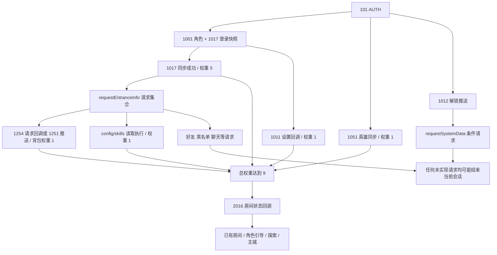

# B 服 224 登录后初始化协议分析

分析日期：2026-10-26（Asia/Shanghai）

本文第 1–10 节保留首次分析时的实现基线与停止位置，其中“当前源码”“未受理”和 13 种请求均指实施前状态
维护者随后授权成组补齐初始化 CMD，并确认 10129 / 2016 以 B224 消费结构为准
第一批补丁新增 15 种请求，合计 28 种；该阶段实现边界见 [初始化查询实现记录](login-init-implementation.md)
2026-10-27 已继续补齐看板、主界面查询及探索场景，当前受理 50 种；2601/2551 仍限于获确认的 B224 初态
17:37:48 新现场在认证后收到 1852 并因未受理断开；本轮探索分支、验证和边界见 [探索协议移植](explore-protocol.md)
本批补丁后，维护者按要求重新登录，已实机反馈“已进入主界面”；只验收该登录路径，不代表剩余系统完整实现
最新状态、完整静态扫描及协作步骤见 [主界面查询补齐](protocol-porting-workflow.md)，下文历史基线保留，不将尚未实机验收的协议写成已打通主界面

22:06:57 新会话已从同一客户端进程确认四处配置断言，维护者随后授权修复现有配置和存档
最新原因、备份隔离范围和验收方法见 [B224 加载阻塞修复](bili224-loading-fix.md)，以下首次分析的未知项不代表仍未取得这些现场证据

## 1. 结论和适用范围

| 结论 | 状态 | 依据与限制 |
|---|---|---|
| 本轮目标是 `com.bilibili.gxjy` 底包 `1.1.224.1` 的本地测试补丁 | 已验证 | 维护者本轮确认；部署历史见 `bili-connection-diagnosis.md`，不把 281 更新脚本当成当前运行脚本 |
| 维护者提供的 00:16:19 会话在收到 10115 后立即因“不支持游戏命令”结束 | 已验证 | 本轮提供的脱敏日志，摘要见第 3 节；没有 10115 下行 |
| 当前工作区源码已经支持 10115，不能通过再次添加同一分支解释上述现场 | 已验证 | `internal/game/commands.go:58`、`runtime.go:338`、`internal/server/session.go:159` |
| 10115 已在这份日志产生后由另一轮 AI 修改补齐 | 已验证 | 维护者本轮补充确认修复时序，且当前源码确有分支；这解释了日志与源码的差异，不再据此怀疑运行了错误版本 |
| 当前 Go 遇到未实现 CMD 会返回错误并关闭该会话，不是继续等待下一条 CMD | 已验证 | `session.dispatch → run → App.GameHandler`；旧架构文档中的空成功兜底已不符合当前实现 |
| 加载进度依赖五类事件，权重合计 9；进度完成后还有 2016 的回调依赖 | 已验证 | B224 `LoginController`、`LoginView.updateProgress`、`PvpFightModel.requestRoomInfo`，详见第 4 节 |
| 当前默认表与 B224 存在实际装备、解锁配置差异 | 已验证 | 本轮在内存读取本地配置：装备 67 对 53 行，解锁 147 对 188 行；Go 选择的三种起手装备均不在 B224 表中 |
| 下一步应闭合初始化请求集合并核对客户端数据引用 | 推测 | 10115 是已修复的历史断点；修复后的首个实际阻塞点仍需新会话验证，不能预报为某个固定编号 |
| 当前卡住完全由资源问题或某个下行编号造成 | 未知 | 没有本次同一会话的客户端异常栈、五类事件状态或资源失败日志，不能据历史其他版本日志认定 |

“已验证”只证明表中注明的层次：源码行为、离线原函数执行、配置内容或现场日志
它不自动表示真实客户端已经完成该协议或进入主界面
“推测”表示待验证的原因或实施建议；“未知”表示没有足够证据确定语义、取值、时序或现场状态

## 2. 证据索引

以下路径相对于 `gxjy-server/`，Python 发布包路径中的 `../` 指向仓库根目录
所有客户端、原型和完整日志继续留在原有忽略目录，本文只记录必要字段、统计与来源

| 标识 | 来源 | 本轮用途 |
|---|---|---|
| G1 | `internal/protocol/frame.go`、`msgpack.go`；`internal/crypto/handshake.go`、`cc2p.go` | 上下行帧、解密、正文解码与失败边界 |
| G2 | `internal/server/session.go`、`server.go`、`protocol_values.go` | 收包、命名、CMD 受理、业务调用、顺序发送与断开 |
| G3 | `internal/game/commands.go`、`runtime.go`、`login_state.go` | 当前 13 种请求和 10 种主动推送 |
| G4 | `internal/game/heroes.go`、`equipment.go`、`chapters.go`、`tasks.go`、`month_card.go` | 业务字段、配置引用、查询副作用与错误 |
| P1 | `../gxjy-release-20261019/gxjy-release-20261019/2-SERVER/protocol/gxjy_server.py` | 原型 `Session.dispatch` 及登录、背包、任务等函数；SHA-256 为 `13ef3e5dfcda8ed996693711c5c573df533b41b89d812d49ce4a132fc49bda25` |
| C224 | `data/assets/bili/analysis/local-client/base224-local/original-index.js` | 当前目标底包的原始主脚本；SHA-256 为 `89513c054d788a55617a86b4820578019b0135e5f3aeb86692bb76b1af39d5c6` |
| C224P | 同目录 `patched-index.js` | 本地补丁脚本；SHA-256 为 `455a5ba93f1064c5173c4324e00083237532eb50d80b9494873129404454029d`；既有部署记录说明只改登录地址、启动标记和测试公钥，本轮不重新部署 |
| T224 | `data/assets/bili/source/apk/assets/assets/resources/` 下的 Bundle 和 import 表 | 原 APK 的 224 协议表、装备、英雄、初始配置和解锁条件，在内存解码、合并分表 |
| TGO | `config.json` 的默认 `asset_root=data/assets`、`bundle_config=data/assets/resources/config.json`、`protocol_map=data/protocol/protocol_map.json` | 核对默认服务端数据；现场是否存在命令行覆盖未知 |
| C281 | `data/assets/bili/analysis/verified/index.js`、`protocol_map.json` | 辅助比较；业务结论不能无条件外推到 224 |
| LNOW | 本轮维护者提供的 `2026-10-26 00:16:19` 日志 | 当前断线证据，按方向、CMD 和序号摘要记录 |
| UFIX | 维护者本轮补充说明：日志出现后已第一时间让 AI 修复 | 解释 10115 日志与源码的先后关系；未附修复后的同会话日志 |
| LPY | `../gxjy-release-20261019/gxjy-release-20261019/save-python-test/server_live.log` | 历史 Python 加密会话统计；客户端具体版本未在本轮确认，不能作为 B224 成功验收 |
| LTW | `../gxjy-release-20261019/client-log.txt`、`client-login-resource-analysis.md` | 历史 `com.komoegame.gxjytw` 的资源故障，仅用于区分问题类型 |
| TEST | `internal/game/testdata/`、`internal/server/testdata/`、`internal/protocol/testdata/` 和对应测试 | 合成 Python 差分、HTTP/WS、B 服帧样本和错误边界 |

T224 协议表的原始文件和 SHA-256：

| 文件（相对于 T224） | SHA-256 |
|---|---|
| `import/14/14455dfa-8cc5-4a7b-acf8-1104c183b503.json`，`SERVER_Protocol` | `d17283ede1f987257dfd067ed8f3e00e49af03a42786b58f0642cfbbc1d9eac2` |
| `import/89/89a438ff-ef29-4779-97eb-a197cf3cb43e.json`，`SERVER_Protocol_sub1` | `941de60d119f4bb607c6df48727e9114949f8cde0d7ecb83e114a7ffa65ce29d` |

**已验证**：本轮按客户端后表覆盖规则合并 T224 协议表，与 C281 已有映射逐项比较，名称和编号完全相等
排序键、紧凑 JSON 的映射 SHA-256 为 `2c0e8600ff3ff1abd3b4006c646f10674c783732ee6fcc8329f411c5589bbb08`
这只确认这两份编号表相同，不代表所有业务字段、配置或客户端实现相同

工作区开始时 `.gitignore`、`.idea/`、`AGENTS.md` 和整个 `gxjy-server/` 均为未跟踪项
既有提交不能代表当前代码版本，不能用 HEAD 的提交号给这次运行程序定版

## 3. 当前链路与现场时间线

### 3.1 HTTP 和 WebSocket 边界

**已验证，客户端构造和 Go 当前行为**：HTTP 登录由 `internal/server/login.go` 处理，B 客户端先 POST `player/getResource`、POST `player/login`，再 GET `player/enter`，使用顶层 `gate_ip/port/type` 连接 `/game` 并请求 101
HTTP 成功和 101 成功都不等于游戏初始化完成
渠道认证本身、正式账号策略不在已确认兼容范围

**已验证，G1/G2 和既有帧测试**：

```text
上行 WS 二进制消息
  0x01 | varint(RSA字节数) | RSA区块 | ciphertext | tag[16] | nonce[12]
解密正文
  frameSequence:u32大端 | command:u16大端 | MessagePack({msg:业务值,seq:请求序号})

下行 WS 二进制消息
  varint(1+加密载荷长度) | 0x01 | ciphertext | tag[16] | nonce[12]
解密正文
  serverSequence:u32大端 | command:u16大端 | MessagePack(响应对象)
```

首个加密包恢复会话密钥；后续包可以不带 RSA 区块
帧序号和 MessagePack 中的请求 `seq` 是两个计数器
Go 当前忽略请求帧序号，业务层解开 `{msg,seq}`，下行使用会话自身递增的序号
C224 `NetNode.onMessage:370503` 检查下行序号间隙，按 CMD 匹配待处理回调；没有匹配的回调才进入对应主动推送监听器

**已验证，G2/G3**：真实调用链为：

```text
App.GameHandler
  → gameSession.run
  → decode / ParseClientPacket / RecoverSessionKey / DecodeClientBody
  → gameSession.dispatch 的 game.CommandName 白名单
  → GameState.handle / protocolValueJSON / decodeRequestJSON
  → Runtime.Handle（单锁，返回有序 []Message）
  → anyProtocolValue → gameSession.send → BuildServerFrame → writeBinary
```

协议映射只影响日志名称，不注册 Handler
即使映射知道名字，`CommandName` 不受理仍会失败
业务、转换或发送错误沿调用链返回；会话退出后 `GameHandler` 关闭连接
发送日志在写入成功之后记录，仅证明服务端这次写入没有报错

### 3.2 本次现场摘要

**已验证，LNOW，所有事件发生在 2026-10-26 00:16:19**：

| 方向 | CMD / 名称 | 服务端下行序号 |
|---|---|---:|
| C→S | 101 / MSG_TYPE_AUTH | — |
| S→C | 101 / MSG_TYPE_AUTH | 1 |
| S→C | 1001 / MSG_ROLE_INFO_RES | 2 |
| S→C | 1017 / MSG_LOGIN_INFO_RES | 3 |
| S→C | 1051 / MSG_HEROS_RES | 4 |
| S→C | 1201 / MSG_TEAMS_RES | 5 |
| S→C | 1851 / MSG_WORLD_MAP | 6 |
| S→C | 1012 / MSG_SYSTEM_UNLOCK_RES | 7 |
| S→C | 906 / MSG_PUSH_REMINDS | 8 |
| S→C | 903 / MSG_RED_POINTS_RES | 9 |
| S→C | 2419 / MSG_SYNC_BASE_INFO | 10 |
| S→C | 1951 / MSG_REQ_ACTIVITIES | 11 |
| C→S | 10115 / MSG_GET_CHAT_INFO | — |
| 会话结束 | 不支持游戏命令：command=10115 | 没有 10115 回包 |

**已验证**：本次日志包含 2 种入站 CMD、11 个不同 CMD 的下行消息、1 次未支持错误
10115 的名称已经被识别，因此现场属于“已命名但未受理”，不是“无法识别编号”
**未知**：此片段之前或之后是否还有其他连接，客户端是否已处理全部 11 个下行，以及每类加载事件是否已发出

**已验证**：10115 在日志所对应程序中缺失，错误结束会话，打断了当次初始化
维护者补充确认，这份日志之后已让 AI 修复，当前源码确有该分支；两者差异的修复时序已有解释
**未知**：修复后实际走到哪一步，没有新会话日志；不能继续把 10115 当作当前缺失项或断言存在构建版本问题
本轮查询进程元数据被系统拒绝访问，未确定正在运行的可执行文件，也未停止或替换服务；这不影响上述时序解释

## 4. 已确认的初始化依赖

### 4.1 五类加载事件和加载后的房间检查

以下均为 **已验证的 C224 静态控制流**，不是推测出的游戏服务器设计：

| 事件 | 权重 | 触发依据 | 失败或缺失的影响 |
|---|---:|---|---|
| `EVT_MSG_LOGIN_INFO` | 5 | `PlayerModel.initPush:381895` 处理 1017，先执行 `syncLoginInfo`，完成后 emit | 同步函数抛错时，不到 emit；`requestEntranceInfo` 也不会由此监听器启动 |
| `EVT_MSG_HEROS_RES` | 1 | `HeroListModel.synchronize:311374` 消费 `heros`，完成同步后 emit；分页时依赖 max/count | 无效配置引用或未完成分页会阻止该事件 |
| `EVT_MSG_BAG_RES` | 1 | `BagModel.requestBagData:127187` 的 1254 回调或 `initPush:126734` 的 1251 监听器，均调用 synchronize | 同步物品失败或分页未完成会阻止该事件 |
| `EVT_GET_CUSTOMDATA_SUCC` | 1 | `CustomDataModel.requestGet:200211` 收到 1011，result 成功，先同步设置再 emit | 没有回包、失败结果或同步异常会阻止该事件 |
| `EVT_BATTLESKILL_LOAD_SUCC` | 1 | `requestEntranceInfo:337876` 等待 `DataReader.loadAllSkillScript` 的回调 | 是本地 `config/skills/` 读取/执行链，不能用补网络 CMD 代替 |

来源：`LoginController:337091` 声明权重，`:337122` 注册监听器，`:337306` 计算总权重，`:337320` 每次刷新消费一个待加权值
`LoginView.updateProgress:339308` 在当前权重等于总权重时调用 `enterHomeView`
这不是“等待 9 个不同 CMD”，也没有独立的“初始化完成 CMD”证据

**已验证**：`enterHomeView:337266` 先请求 `PvpFightModel.requestRoomInfo(false, callback)`，即 **2016**，之后才决定进入已有房间、主城或引导
C224 `:386084` 发送 `{show_error:false,version:战斗校验版本}`；无 `room_info` 时调用 `callback(false)`，登录控制器才继续执行
因此 2016 虽不占加载进度权重，仍是后续入口依赖，不能留到“进入主城以后”再处理

**已验证**：之后根据 `G_Config.closeGuide`、`GuideAgent.getIsCloseGuide()`、设置 `IsChooseLearder`、探索/章节状态决定去向
`IsChooseLearder` 是原脚本拼写，1015 成功后客户端通过 1013 保存它
`GuideAgent:432315/432344` 读取 `IsSkinGuide` 等标记；本轮未擅自写这些标记强行跳过引导
**未知**：维护者实际测试存档应走新角色引导还是已有角色直接回主城，需要在测试案例中固定



图中的并列边表示依赖，不规定异步请求的全局到达顺序
**已验证**：客户端事件处理、网络接收与服务端写入可以交错；服务端顺序写出 11 个包不代表客户端已按业务要求消费全部内容

### 4.2 登录快照触发的两条请求链

**已验证，C224 `PlayerModel.syncLoginInfo:382029`**：先同步 Role，条件请求下载奖励，发起设置读取；随后处理可选 Chapter/Scene/Resource/Activity/Team/Mount 等快照、月卡状态和 summit，再调用 TaskModel、FightTogetherModel、RoguelikeModel 的 `requestForLoading`
各模块请求可能受解锁和活动状态限制，不是每次登录都会全部发送
当前 Go 的 1017 含 Role、Resource.heros、summit，不含上述所有可选块，不能单凭字段可选就认定它们是必补内容

**已验证**：月卡调用链为 `ActivityModel.requestMonthSingleCardState:49342 → ShopModel.checkMonthCardIsBuy:416093 → requestMonthCard:416249 → 1670`
购买状态检查直接访问 `_monthCardData["ShopMonthCard_Permanent"].inactive_time`，因此成功响应不能只给空 month_card 或遗漏该键；当前 Go 按表枚举卡项，需同时验证有效配置包含该项，不能仅检查 1670 已有 Handler

**已验证，C224 `LoginModel.requestEntranceInfo:337858`**：收到登录事件后，按方法调用顺序进行：

1. 公会查询（条件）、爬塔查询（条件）
2. 背包 `{start:0,stop:50,version:当前背包版本}`
3. 聊天频道（条件）、好友（条件）、黑名单 `{start:1,stop:20}`、私聊联系人 `{chat_id:角色ID}`
4. 实时竞技场赛季（条件）、离线竞技场（条件）、公平竞技场（条件）
5. 加载技能脚本并回调事件、抽卡系统查询（条件）

**已验证，C224 `PlayerModel.requestSystemData:382380`**：1012 解锁推送还会按键触发章节、资源关卡、爬塔、聊天、竞技场、Rogue 等查询
因此只列 `requestEntranceInfo` 仍会漏掉初始化请求，也不能假设 10115 只会出现一次

### 4.3 登录推送顺序

**已验证，G3、P1:8815、TEST**：当前 Go 和原型顺序为：

```text
101 → 1001 → 1017 → 1051 → 1201 → 1851 → 1012 → 906 → 903 → 2419 → 1951
```

1015 选择队长成功后是 `1015 → 1051 → 1201 → 1851 → 1012 → 906 → 903 → 2419 → 1951`
1301 章节查询前另发 `1851 → 1301`
P1:8810 解释了 1017 放在 1012 前以避开旧客户端控件初始化异常的原因；**推测**该约束对本轮目标仍有价值，但不能把原型注释当作已完成 B224 实机时序证明
方案默认保留现有顺序，以 B224 客户端回放验证，不无依据重排

## 5. CMD 统计和请求/响应结构

### 5.1 统计口径

| 集合 | 数量 | 状态与解释 |
|---|---:|---|
| 当前 Go 接受的请求编号 | 13 | 已验证：逐一核对 `CommandName` 与 `Runtime.Handle`，见 5.2 |
| AUTH 下行消息数 | 11 | 已验证：包含 AUTH 响应和 10 个主动推送 |
| 当前日志名称映射 | 554 个名称 / 536 个不同编号 | 已验证：TGO；不是 554 个已实现请求 |
| B224 合并协议映射 | 661 个名称 / 642 个不同编号 | 已验证：T224；有 19 组编号别名，含服务间命令，不能把全表都当成客户端请求 |
| B224 中当前映射缺少的名称 | 107 | 已验证：原有 554 项都在且未改号；2551、2601 在条件初始化链中可实际被请求 |
| Python dispatch 明确按名称分派的命令 | 110 | 已验证：AST 统计 name 比较及被引用的常量集合，含 1 个无编号名称；不含通用兜底 |
| 上述 Python 名称中 Go 未受理 | 97 | 已验证：96 个有现有编号，另 1 个 `MSG_GAIN_STAR_REWARD` 在两份映射都缺编号；这不表示 97 个都阻塞登录 |
| LNOW 已观察到但当时未受理 | 1 | 已验证：10115；维护者确认日志后已修复，当前源码已受理 |
| LPY 历史入站样本 | 66 次 / 25 种 CMD | 已验证：只计 `[gate] <-`，不混入响应、注释或重复 UNHANDLED 行；见 5.6 |

**未知**：完整运行时实际“无法识别”的 CMD 数量
本次现场没有无法命名编号，只有一个已命名未受理编号
2551、2601 的作用可由 B224 表和调用方确认，但使用当前旧映射时可能显示 `MSG_2551`、`MSG_2601`，这不能解释成“协议无法分析”
其余 105 个缺失名称不能直接列为登录必需项，需调用链或现场证据

### 5.2 已受理请求（13 种）

本表的结构为 **已验证的当前 Go / Python 行为**，B224 已直接核对的读取点另列；完整正式协议及错误码仍未知
`Base` 表示 `{result:int,cmd:string}`，成功时 result=0；业务字段在顶层，不放入统一 `data` 包装
请求列描述解开 `{msg,seq}` 后的业务值，Go 当前没有读取的字段不表示客户端不发送

| CMD / 名称 | 请求业务字段 | 当前响应和后续消息 | 证据 / B224 边界 |
|---|---|---|---|
| 101 MSG_TYPE_AUTH | B224 发送 openid、token、is_reconnected 和设备/区服/版本元数据；Go 没有业务必填校验 | Base，然后 10 个推送，顺序见 4.3 | G3:245；P1:8800；C224:338611；本地原型认证行为不等于正式鉴权 |
| 901 MSG_HEARTBEAT | clientTimestamp，可缺失 | Base + server_timestamp（毫秒），原值回显 clientTimestamp | G3:253；C224 NetNode 心跳还读取 timezone_offset，Go 未给该字段，影响未知 |
| 1003 MSG_RANDOM_ROLE_NAME | Go 不读取业务字段 | Base + role_name:string | G3:259；名字来自三段配置池，不能固定伪造名字掩盖缺表 |
| 1004 MSG_UPDATE_ROLE_NAME | role_name | Role + cmd；非空名字保存 | G3:262；角色构造可能恢复体力并落盘 |
| 1011 MSG_REQ_FRONT_SETTINGS | C224 发送 null | Base + settings:{common:object,need_reset:object} + version:0 | G3:293；P1:8875；C224:200211；读取本身不保存 |
| 1013 MSG_SAVE_FRONT_SETTINGS | settings.common / settings.need_reset 对象 | 同 1011；按组逐键合并并保存 | G3:293；P1:8886；不能丢弃 Story、IsChooseLearder 等真实进度 |
| 1015 MSG_CHOOSE_INIT_LEADER | leader_id；Go 也接受 role_name | Role + cmd，然后 8 个推送 | G3:262；C224:382298；保存队长与性别，不能通过固定成功跳过状态修改 |
| 1016 MSG_REQ_DOWNLOAD_REWARD | C224 发送 {}，有下载状态前置条件 | Base + rewards:[] | G3:308；P1:10102；C224:382997；空数组是原型明确行为，未证明正式奖励规则 |
| 1254 MSG_REQ_BAG | C224 发送 start/stop/version；Go 当前不按页处理 | Base + items:map<实例ID,BagItem> + max_count:0 + version:int；每次递增版本，不主动保存 | G3:311；P1:6638；C224:127187；同号请求回调已离线验证，详见 5.5 |
| 1301 MSG_CHAPTERS | 当前 Go 不读取业务字段 | 先 1851，再 Base + version/chapters/pass_rewards/auto_info | G3:317；`chapters.go`；缺失 patrol_auto 时创建内存状态，不主动保存 |
| 1552 MSG_REQ_TASK | C224 发送 version，Go 主要读取任务状态和表 | Base + tasks:map<任务类型,map<任务ID,{process,status,reset_time,guide}>> | G3:331、`tasks.go`；C224:442821；按查询推进任务可能发奖励和保存，并非纯只读 |
| 1670 MSG_REQ_MONTH_CARD | C224 ShopModel 发送 {} | Base + month_card:map<卡ID,{unlock:bool,inactive_time:int}> | G3:324、`month_card.go`；C224:416249；配置损坏返回错误，表缺失/空表有原型固定回退，见错误审计 |
| 10115 MSG_GET_CHAT_INFO | C224 发送 {} | Base + chat_info:{world_channel_line:1,max_world_channel_line:1} | G3:338；P1:8961；C224:191351；结构消费已确认，当前仅原型单频道模型，没有完整聊天业务或本命令专项实机验收 |

### 5.3 主动推送的结构（10 种）

本表均为 **已验证的当前实现**；这些编号能被发送，不代表同号客户端请求已受理
完整嵌套字段和原型差分范围也可参照 `command-inventory.md` 的共享类型及 `existing-paths-alignment.md`

| CMD | 当前顶层载荷 | 依据及边界 |
|---|---|---|
| 1001 | Role | `login_state.go:43`；result、id/uid、name/role_name、level/exp、exterior、server_timestamp/server_time（秒）、stamina_pool；currency 非空才出现 |
| 1017 | {result,Role,Resource:{heros},summit} | `runtime.go:251`；字段大小写有意义，不能改为 role/resource；C224:382029 逐块读取 |
| 1051 | {result,heros:map<英雄ID,HeroRecord>} | `heroes.go:208`；HeroRecord 有 level/exp/cost、base_attr、hero_surfaces、favor_id/favor_exp、leader_attrs、skills；C224:311374 在同步完成后发事件 |
| 1201 | {result,teams,used_team,expand_teams} | `login_state.go:174`；Team 有 team_id、leader、members、team_name、leader_team_skills、slots |
| 1851 | {result,unlock_world_map,unlock_region_map,unlock_main_map} | `login_state.go:103`；三个 map 的值为 bool；独立 1851 请求未受理 |
| 1012 | {result,unlock_ids:map<系统ID,bool>} | `login_state.go:73`；C224:382369 触发后续请求，错误解锁会扩大未实现 CMD 集合 |
| 906 | {result,reminds:[]} | `runtime.go:240`；原型空提醒，不是已实现提醒奖励业务 |
| 903 | {result,red_points:{}} | `runtime.go:241`；原型空红点，不是所有系统红点均已兼容 |
| 2419 | {result,summitBaseId,stage,actInfo:{isActOpen,openTime,closeTime},level,rank,score,heroes,records} | `login_state.go:144`；当前活动固定关闭，英雄和记录为空；不能与 2401 请求混淆 |
| 1951 | {result,activities:map<活动ID,Activity>} | `login_state.go:149`；Activity 含 status/start_time/end_time/is_new/unlock/num/reward_info，签到有 extra_info.cum_rewards；独立 1951 请求未受理 |

BagItem 的当前结构为 `{count,template_id,item_type,data}`
装备 data 有 user/attrs/locked/exp/level_id/quality/star/enchantment/template_id，普通物品 data 有 is_new
**已验证**：这些字段存在不代表引用有效，B224 的装备模板与进度 ID 必须单独核对

### 5.4 初始化相关缺失请求及已知结构

下表所有“Go 未受理”均为 **已验证的当前源码状态**
客户端字段消费为已验证，表中原型固定状态只证明 P1 行为，不自动成为 B224 正式业务规则
未确认部分明确标为未知，不建议照着形似的成功壳实现

| CMD / 名称 | 触发及请求 | 已确认的响应消费 / 原型行为 | 尚未确认与优先级 |
|---|---|---|---|
| 10101 MSG_GET_FRIENDS | FriendModel.requestData，好友解锁后；{start:1,stop:20,type:0} | C224:270302/270697 读取 friends 映射、max_count 和可选 version；P1:10097 为 friends:{}、max_count:0 | 已验证空集合原型结构；实际好友、分页版本未知；推测 P1 |
| 10124 MSG_REQ_BLACKLIST | requestEntranceInfo 直接请求；{start:1,stop:20} | C224:270851 读取 blacklist；P1:8970 为 []，空值在该遍历分支可消费 | 列表非空时的表示、分页及状态未知；推测 P1 |
| 10129 MSG_GET_CHAT_LIST | requestEntranceInfo 直接请求；{chat_id:角色ID} | C224:270729/270323 读取 **contactList**；P1:8967 输出 **chat_list:[]** | 已验证原型与 B224 消费字段不一致；正式空联系人表示和版本语义未知，不能静默照搬或改字段；推测 P1，需决定 |
| 2016 MSG_GET_PVP_ROOM | 加载达到 9 后；{show_error:false,version:战斗校验版本} | C224:386084 检查 **room_info**，缺失时 callback(false)；P1:9023 为 **rooms:[]** | 已验证无房间时客户端走继续入口分支；非空房间、正式空态编码未知，需限定无房间案例；推测 P1 |
| 905 MSG_CLIENT_TRACKING | StatisticModel 条件统计；{track_type,track_info} | C224:431343 仅按 result 打印结果；P1:9871 是显式 pass 后 ACK | 已验证这是有明确原型分支的 ACK，不是任意未知 CMD 成功兜底；统计接收/保存语义未知，按维护者禁止假成功要求先确认范围；推测 P1 |
| 10151 MSG_GET_CLUB | requestGuild 在 Player_Club 解锁后；{version} | C224:288850/288975：有公会看 club_info/member_info；无公会仍直接读 member_info.invite_num/quit_cd 和 clubs；P1:10000 给出 version/member_info/clubs | 已验证空公会也不能只回 result；成员和真实公会规则未知；推测 P2 |
| 2101 MSG_REQ_TOWER_INFO | TowerModel.requestForLoading 或 1012 解锁；{} | C224:456986 调用 synchronize；P1:9844 返回 points:{},cum_rewards:{},end_time:0 | 已验证原型必须提供 points；B224 的完整赛季/进度结构未知，需按实际 TowerModel 与配置回放；推测 P2 |
| 1810 MSG_ARENA_BASIC | 离线竞技场解锁后先查赛季；{} | C224:110848 读取 arena.season，随后可能查询 1802；P1:10115 提供 season/rank/score/opponents | 配置引用和赛季实际状态未知；不能发固定开放赛季制造后续请求；推测 P2 |
| 1802 MSG_ARENA_INFO | 1012 或 1810 后触发；参数以 requestArenaInfo 调用为准 | C224:110661 消费 arena 下的 season、rank、score、opponents、阵容等可选字段；P1 与 1810 共用分支 | 已验证字段读取；完整请求参数、默认阵容和赛季策略未知；推测 P2 |
| 1701 MSG_REAL_ARENA_BASIC | 实时竞技场解锁后；{} | C224:116505/116271 读取 arena.season.status/season_config_id，后者必须引用 ArenaRealTimeBase；P1:10106 提供固定赛季 | 已验证开放状态会触发 1702；不能只实现 1701；真实赛季规则未知；推测 P2 |
| 1702 MSG_REAL_ARENA_INFO | 1701 的 status 为真后；{type:int}，加载路径为 0 | C224:116532 读取 arena.arena_info；P1 无独立分支，历史 LPY 中也落入 UNHANDLED | 已验证连原型也有缺口；完整 arena_info 和真实对手等未知；推测 P2，需专项证据 |
| 2351 MSG_FAIR_ARENA_INFO | 公平竞技场解锁后；{req_pool:true} | C224:254872/254611 读取 arena.season_config_id/status/win_time/max_win_num/lose_time/reset_time 等；P1:10123 给固定状态 | 配置引用必须有效，实际匹配池、赛季状态未知；推测 P2 |
| 1601 MSG_DRAWCARD_SYSTEM | DrawModel 解锁后；{} | C224:209045 调用 synchronize；P1:4712 gacha_system 生成 card_pool、ssr_probable 等，真实池 ID 指向 DrawCard | 已验证不可用空 data 代替卡池；B224 池状态和完整差分未知；推测 P2 |
| 1951 MSG_REQ_ACTIVITIES | ActivityModel.requestForLoading 等；{activity_id:null或目标ID} | C224:49201 读取 activities；P1:9775 使用 draw_activity_payload | 已验证 Go 仅登录推送、没有请求路径；活动状态与过滤语义未知；推测 P2 |
| 1151 MSG_REQ_RESOURCE_MAP | 1012 解锁触发 ResourcesModel.requestBlockData | P1:9512 有分支；C224:382388 证明调用来源 | 已验证 Go 未受理；本轮未逐字段确认请求和资源关卡响应，均未知，不作为首批可直接实现项；推测 P2 |
| 1851 MSG_WORLD_MAP（请求方向） | 地图/探索查询，历史 LPY 有 1 次入站 | G3 已有同号推送结构；P1:9791 有请求分支 | 已验证同号推送不等于请求处理；B224 具体请求字段/分支触发仍未知；推测 P2 |
| 2601 MSG_GET_FT_INFO | FightTogetherModel.requestForLoading，解锁后；{} | C224:261411/261242 读取 playerFTInfo.{maxCoin,gainCoin,maxDifficultyId,assistNum,resetTime,collaborator}、bossList[]、actBossIds | 已验证 T224 编号，TGO 缺名称且 P1 无此分支；完整状态、空态和 Boss 引用未知；推测 P2，先补证据 |
| 2551 MSG_REQUEST_ROGUE_INFO | RoguelikeModel.requestForLoading，解锁后；{} | C224:404618/403875 读取 remain_times、received_score、unlock_talent、reset_time、week_score 等及节点/英雄/图鉴数据，末尾 initData | 已验证 T224 编号，TGO 缺名称且 P1 无此分支；完整结构、有效引用和初始状态未知；推测 P2，先补证据 |
| 108 MSG_TYPE_RESUME_RESPONSE | 下行出现序号间隙时；{start,end} | C224:370758 请求缺失范围，回调检查 result；需要正确的历史消息补发语义 | 已验证当前 Go 未受理；重放/重连窗口未知，不能回成功却不补发；推测 P3，干净连接先验证无间隙 |

P1/P2/P3 为第 8 节的推荐优先级，不代表当前版本已实现
没有证据要求每个低等级角色都走完所有竞技场、公会或活动流程

### 5.5 背包编号：对旧报告的限定与冲突

**已验证**：C224 同时存在两条路径：

- `BagModel.initPush:126734` 监听 1251
- `BagModel.requestBagData:127187` 发 1254 并注册同号回调，回调调用同一个 synchronize

**已验证，本轮隔离执行原函数**：在 Node VM 中提取 C224 原 `NetNode.request/onMessage`、`BagModel.requestBagData/synchronize`，固定源码哈希，使用合成空背包，网络、事件总线和基类用内存替身：

| 输入 | 结果 |
|---|---|
| 已有 1254 请求，收到 1254 成功响应 | 背包事件 1 次，待处理请求减少到 0 |
| 已有 1254 请求，只收到 1251，无推送监听器 | 背包事件 0 次，1254 请求仍待处理 |
| 已有 1254 请求，收到 1251，已注册推送监听器 | 背包事件 1 次，1254 请求仍待处理 |

因此，`bili-runtime-validation.md` 仅凭 `initPush` 注册 1251 推断“1254 必然路由错误”，不能作为本轮改号依据
该报告中装备和属性等其他发现需分别核对，不因这一冲突全部作废
**未知**：真实非空背包、分页、增量和重连组合是否均兼容

**推测，方案约束**：保留请求响应与主动推送的区别，不盲目把 1254 改成 1251，也不同时发两个编号来碰运气
C224 登录权重监听没有按事件去重，重复发送可能造成重复计权；完整影响需回放验证

### 5.6 历史日志样本与当前缺口

以下均为 **已验证的 LPY 入站统计**，客户端版本及是否最终成功进入主界面未知
它提供候选集合，不覆盖当前 LNOW，也不能混作 B224 实机证据

| 当前受理情况 | CMD:入站次数 |
|---|---|
| 当前 Go 已受理，9 种 | 101:3，901:6，1011:3，1013:9，1254:3，1301:4，1552:3，1670:4，10115:7 |
| 当前 Go 未受理，16 种 | 1014:1，1151:1，1601:1，1701:1，1702:1，1802:1，1851:1，1854:1，1951:1，1955:1，2016:3，2101:1，2351:1，10101:3，10124:3，10129:3 |

LPY 唯一 UNHANDLED 是 `11:50:55 / 1702 / MSG_REAL_ARENA_INFO`
其他命令有原型分支也不代表 Go 已实现或真实业务完整
额外的 1014（GM）、1854（场景小地图）、1955（公告）在本轮没有证据表明属于五类加载事件的必经路径，其具体请求/响应未在本轮逐字段验证，状态为未知，不能因日志出现就列入首批初始化补丁

## 6. 四类阻塞因素的区分

### 6.1 协议缺失与修复时序

**已验证**：LNOW 的直接中断点是 10115 未受理，返回错误导致会话关闭
**已验证**：维护者确认这份日志之后已修复 10115，当前源码与该说明一致
**未知**：修复后的实际会话进度和首个失败点；本轮没有把旧日志断点当作当前未修复错误
**推测**：10101、10124、10129 和 2016 是比逐个追最新日志更稳定的后续核查集合，因为它们有明确的客户端调用来源；其中 10124、10129 的入口方法不带解锁判断，2016 是加载后的回调关口

**已验证**：`command-inventory.md` 的 1552、1670、10115“未接入”记录落后于当前源码；`architecture.md` 的未知 CMD 空成功描述也已过时
本文按当前源码报告，不静默把旧文档当作事实，旧文档本轮不批量修改

### 6.2 响应结构和配置引用

**已验证，本轮读取 TGO/T224**：

| 项目 | 默认 Go 表 | B224 底包表 | 兼容含义 |
|---|---|---|---|
| EquipBase | 67 行，存在 Equip_S3_1/2/3 | 53 行，这三个模板及 Equip_S6_1 都不存在，亦无可见 HeroType=[All] 候选 | 默认起手装备选择无法被 B224 的对应模板表解释；把表切到 B224 后当前 fallback 也仍会生成无效模板 |
| Equip_Exp.Config | 本轮未逐值比较 | N→Equip_N_1，S→Equip_S_1 | 当前 equipData 由装备模板 ID 开始找 EquipExp，B224 等级引用应专项核对 |
| UnlockSystem | 147 行 | 188 行 | 服务端与客户端不能共享未经核对的解锁结论 |
| Player_Club | Level 18 | Level 22 | 公会初始化触发范围会不同 |
| Arena_RealTime | Level 23 | Level 32 | 实时竞技场请求集合会不同 |
| Arena_FairPlay | Level 30 | Level 999 | 对普通进度角色过早触发公平竞技场的风险 |
| Player_Rolls | Task SMSPT03_400 | Task SMSPT03_400 | `unlockIDs` 只判断 Level，对 Task 条件默认通过，与客户端任务条件判断存在差异 |

**已验证，源码行为**：`login_state.go:73` 对没有 Level 的对象保留 ok=true；`C224 SystetmKeeper:438900` 对 Task 明确要求任务已领取
`SystetmKeeper:438737` 优先信任服务端 systemIsOpen，因此错误地发 true 会绕过客户端后续条件判断
**未知**：现场存档进度、命令行覆盖配置，以及哪些错误解锁已实际触发请求
这既可能扩大初始化请求范围，也涉及原型兼容与 B224 兼容的取舍，不能为减少 CMD 擅自全关系统

**已验证**：原型 `chat_list` 与 B224 `contactList` 字段冲突；2016 的 `rooms` 也不等于客户端读取的 `room_info`
这些结论应通过维护者确认后的目标契约解决，不能把错误结构包在 result=0 后宣称已兼容
**推测**：无效装备、英雄/技能/头像/场景引用可能令客户端同步函数抛错，导致加载事件没有发出；本次客户端异常栈缺失，尚不能指定哪一项为现场第二个阻塞

### 6.3 消息顺序和时序

**已验证**：Go 当前串行发送有序消息，已通过原型合成顺序测试；下行序号从 1 开始连续递增
C224 有序号补发请求机制、请求回调与推送监听器两套消费路径
**未知**：本次客户端是否观察到序号间隙、回调异常、重复事件或解锁早于数据初始化的异常
**推测**：在没有客户端记录前，应保持已有推送顺序，先对齐回调、结构和引用，不能通过随机调换消息来排除未知 CMD

### 6.4 客户端资源加载

**已验证**：C224 技能事件来自 `DataReader.loadAllSkillScript:201007` 的 `config/skills/` 目录读取、脚本执行和最终回调
它有特定异常处理分支，部分异常仍可能调用回调后 assert，不能笼统写成“任一技能异常必然不发事件”
**未知**：本次该回调是否触发、具体目录是否读取成功、assert 是否中断后续流程

**已验证**：LTW 中曾有 120 条下载 404、13 个最终跳过文件等历史证据，但包名和版本属于另一份客户端
不能据此断定 B224 本轮仍缺这些资源，也不能将服务端配置表完整等同于客户端 native/技能资源完整

**已验证**：`LoginHandler` 仍提供空 manifest 和通用 JSON 路由，没有客户端媒体资源的实际静态服务；历史 B224 补丁曾被空更新清单删除，后来恢复并由维护者确认登录成功
**推测**：这是资源/更新的独立风险，应保留补丁和清单版本身份，不通过清缓存或重复更新进行本轮试错
当前 LNOW 已进入加密业务 CMD，不能把历史 RSA 公钥不匹配当作此会话的首要阻塞

## 7. 关键错误与空成功审计

按维护者本轮要求检查错误传播，以下只报告，不在分析阶段修改行为

| 路径 | 状态 | 当前行为 / 方案要求 |
|---|---|---|
| WS 读失败、短帧、RSA 恢复失败、缺密钥、CC2P 校验失败 | 已验证 | G1/G2 返回错误并退出会话，没有绕过认证标签；此类致命错误继续显式 return |
| 未受理 CMD | 已验证 | `session.go:84` 返回错误，不发成功壳；已有 TestDispatchRejectsUnsupportedCommand |
| 业务加载/存档失败、协议值转换、编码和 writeBinary 失败 | 已验证 | 向上传递；Runtime.save 用 r.err 保留错误，Handle 末尾返回，不发送已构建的成功消息；未证明状态有事务回滚，不能声称失败无副作用 |
| 非法 MessagePack | 已验证，有缺口 | `frame.go:195/214` 把解码错误转换成字符串并置 UsedTextFallback=true；session 未检查该标记，Runtime 的 obj 会将非对象变为 {}，有效已支持 CMD 可能继续生成成功响应 |
| 非法 MessagePack 与兼容要求 | 未知 | TestDecodeClientBodyFallbackAndErrors 明确固定了旧原型文本回退，不能在本轮偷偷删除；建议确认 B224 严格路径应拒绝非法 MessagePack，同时保留有证据要求的其他协议行为 |
| 缺配置行/字段 | 已验证，有缺口 | Runtime.row 返回空对象，skillPayload/heroRecord 可返回 nil，ownedHeroes 可跳过英雄；starterIDs 可能产生不存在的默认装备；缺失关键引用并非都会转为 error |
| 月卡缺表或空表 | 已验证，范围需决定 | 非 ErrTableNotFound 的读取错误返回；缺表/空表时返回两张原型默认月卡，不能据此宣称真实月卡初始化正确；是否在 B224 作为致命配置缺失应明确 |
| 已有空数组/对象 | 已验证，业务不完整 | 1016 rewards、906 reminds、903 red_points、2419 部分字段和活动状态存在原型固定值；它们并非未知 CMD 兜底，但也不能作为完整业务实现验收 |
| HTTP 正文读取/响应写入 | 已验证 | 读取失败或超限直接 400；写入失败记录并 return；getResource 非法 JSON 使用原型空请求回退 |
| HTTP 未识别路径 | 已验证，有边界 | `login.go:123` 后默认返回网关对象，包含 result=0；不是独立资源服务。是否严格限制路由需专项确认，不能用此路径掩盖真实资源缺失 |

**推测，实施原则**：致命解析、校验、状态或资源引用错误应明确结束当前失败路径并报告原因；只对有证据的合法空业务状态返回相应结构
不能将“没有数据”与“读取失败/未实现/尚不知道结构”合并成同一个空成功
由于涉及已固定的原型回退行为，严格化补丁必须明确目标为 B224、列出兼容差异并由维护者确认

## 8. 最小实现方案与优先级（待确认）

本节均为 **推测 / 推荐方案**，没有开始批量修改 Handler
优先复用 `game.CommandName → Runtime.Handle → []Message`，保留现有锁、配置入口、Store 和网络错误传播
不引入数据库、依赖或新分发框架

### P0：固定复现场景和运行身份

1. 沿用已补齐 10115 的源码；下一次验证时记录构建标识、启动目录、有效配置来源和客户端补丁/资源版本，便于将新会话与补丁对应，不记录令牌或密钥
2. 使用独立测试存档，先固定一个已创建角色、无好友/公会/房间的案例；角色进度、引导是否完成必须明确
3. 对齐该案例的 B224 配置引用，先列出有效装备、英雄、技能、队伍、头像和地图引用。涉及新号发放策略不自行选择替代模板；维护者决定后再改
4. 对关键配置缺失和 MessagePack 文本回退提出小补丁，保持致命错误 return；不得用空结果掩盖失败

退出条件：运行身份可追溯，同一会话能对上 CMD 和事件；缺少关键引用明确失败，没有伪成功

### P1：闭合低进度入口请求和加载后回调

1. 保留当前 101、1001、1017、1051、1201、1851、1012、906、903、2419、1951 顺序，回放 B224 的实际消费
2. 复用 1011、1013、1254、1552、1670、10115 已有实现；新增专项验证，避免重复实现
3. 一次核对好友 10101、黑名单 10124、联系人 10129 和房间检查 2016 的完整调用集合。对于无数据案例使用已确认的真实空状态结构；10129 的字段冲突和 2016 的空房间编码先决定，非空业务继续明确标为未支持
4. 核实客户端会否在该场景发 905；若发，明确统计接收契约后实现，不能对任意未知命令套 ACK
5. 保证技能加载事件来自客户端真实资源流程，不通过服务端伪造“加载完成”

退出条件：五类事件各完成预期同步，达到权重 9，2016 回调正常，按存档状态进入主城或目标引导；连续心跳和设置保存正常，未受理命令没有被隐藏

这只是满足明确场景的候选最小闭环，未经过 B224 真实流程回放之前不能声称“这几个 Handler 必然足够”

### P2：按已确认解锁扩展完整初始化集合

- 核对解锁条件，保留尚未达到条件的系统；不能伪造全关闭、全开放或修改进度来躲避请求
- 对达到解锁条件的账号补齐公会、爬塔、资源关卡、活动/抽卡和各竞技场初始化。1701 与 1702 必须作为依赖链处理，不发固定开放赛季后留下未实现的查询
- 2601、2551 在当前旧协议映射和 Python 原型中均缺少完整支撑，先补 B224 消费测试、配置和合法状态证据；不能仅更新名称表就算实现
- 对 1015 新角色路径、1013 引导标记和章节/探索去向使用单独案例，防止重复登录推送或状态丢失

### P3：重连、序号补发和增量数据

- 再处理 108 的真实历史消息重放、重连缓存请求、背包分页/增量和重复事件
- 不对无法补发的缺失消息返回成功，不用同时发送多种响应编号掩盖路由不确定性

### 验证方式

计划复用现有 fixture、可注入时钟、随机源、临时 JSONStore 和双协议 WS 测试
Python 差分用来检查移植一致性；B224 原客户端函数消费用来检查目标客户端结构，二者结论冲突时分别保留并请求维护者决定
至少覆盖：合法空态、有效非空态、关键引用缺失、配置损坏、保存失败、重复登录、设置重载和加载后 2016 回调
验收观察结果是事件、回调、状态和界面去向，不是 Unknown CMD 日志数量下降

## 9. 尚缺证据和后续需要维护者提供的内容

| 缺失项 | 状态 | 用途 / 何时需要 |
|---|---|---|
| 现场服务程序/启动方式/配置覆盖的身份 | 未知 | 下一次验证记录有效配置与构建即可；10115 的差异已由日志后修复解释，不再作为待排查矛盾，不需要账号凭据 |
| 同一次新会话从 101 到首次失败的服务端日志 | 未知 | 当前片段只确定修复前的 10115 断点；后续验证需要新日志，不必现在重复旧场景 |
| 同时间段 B224 的第一条脚本异常栈、加载进度、关键资源失败信息 | 未知 | 区分数据消费异常、技能目录失败和网络断线；只提供脱敏最小片段，不需要整包抓取 |
| 五类事件是否到达、2016 是否发出和完成 | 未知 | 最小闭环补丁可测试时再按清单观察；优先使用已有诊断能力，若需改客户端诊断另行说明 |
| 测试角色是新号还是已有进度、应进入主城还是引导 | 未知 | 固定独立测试样本，不读取或修改真实玩家进度来制造通过 |
| B224 初始装备/英雄/资源发放策略 | 未知 | 配置显示 H007/H016/H015 等默认值，但不能仅凭表名决定具体发放时机；需要维护者选择兼容目标或合法服务端样本 |
| 10129、2016 及非空社交状态的服务端样本 | 未知 | 客户端字段消费已知，正式空态和完整状态尚不足；可先确认仅无联系人/无房间测试契约 |
| 1702、2551、2601 等条件初始化的真实状态与响应 | 未知 | 不妨碍完成报告；对应账号实际触发前或实现前需要，不索取正式账号和会话密钥 |

下一轮需要维护者确认的实现决策：以 B224 消费契约处理与 Python 的字段差异；关键解析/配置错误的严格边界；新角色初始化和合法空业务状态的范围
确认前保持本轮分析结果，不擅自选定原型、客户端或旧测试中的某一个为唯一真相

## 10. 本轮实际验证和停止位置

**已验证，实际执行**：

- 阅读根 AGENTS.md、README、现有架构/兼容/迁移/客户端报告、Go 依赖和检查脚本，开始时检查 Git 状态
- 静态检查 G1–G4、P1 dispatch/登录/背包/社交/房间分支、C224 的网络回调和初始化调用链
- 用 Python AST 统计 P1 的命名分支，用方向限定正则统计 LPY 的 66 次入站、25 种 CMD 和唯一 UNHANDLED；未将完整正文纳入本文
- 复用 `scripts/decode_bili_scripts.py` 已确认的原型解码原语，只在内存解析 T224 和默认 TGO 的必要表，核对协议编号、分表、装备/解锁/初始配置；没有改写资源、生成客户端副本或读取玩家存档
- 在 Node VM 中隔离执行 C224 原始网络/背包方法，用合成空背包验证 1254 回调与 1251 推送区别；未覆盖真实非空物品、分页或整客户端入口
- 在 `gxjy-server/` 执行：`& 'C:\Program Files\Go\bin\go.exe' test ./internal/server ./internal/game ./internal/protocol ./internal/crypto -count=1`，四包通过

第一次 Go 测试因沙箱不能访问本机 go-build 缓存失败，随后经工具权限批准重跑同一命令成功
测试环境未设置本地 B 服/真实资源差分入口，使用现有合成数据、临时存档及本机测试服务器，没有连接正式服务
默认通过不等于 B224 全部业务验收；未为本文新增代码测试，也未宣称缺少的 Handler 已通过

**未执行 / 未确认**：实机重测、进程重启、构建部署、真实 Python 服务对照、全部 B224 业务表验收、非空背包完整消费、资源下载、完整主城进入和 race
仅新增文档，没有重复全仓 gofmt/vet/build，也没有运行写入已有 B 服报告目录的专项验证脚本

停止位置：现状分析、证据化报告和最小实现方案已完成，等待维护者确认实现范围与冲突契约
本轮不提交、不推送、不发布，不批量增加 Handler，不改变错误策略
